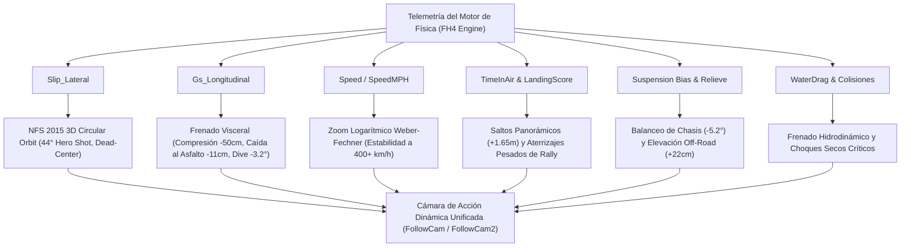

# 🏎️ Horizon-Visceral — Need for Speed (2015) Action Camera & Dynamic Telemetry Mod

[](https://forza.net/)
[]()
[]()
[-red.svg)](LICENSE)
[](https://github.com/DriifterSelf)

Un mod de física de cámara cinemática de alta acción para **Forza Horizon 4**, inspirado en la legendaria cámara de persecución dinámica de **Need for Speed (2015)** presentada en el E3.

Transforma por completo las cámaras de seguimiento exteriores rígidas y desconectadas de Forza en una experiencia visceral, reactiva y cinematográfica que traduce cada gramo de telemetría del coche (fuerzas G, derrapes, suspensión, saltos, vados de agua y colisiones) directamente al encuadre visual.

---

## 🌟 Características Principales



1. **Cámara de Derrape NFS 2015 con Órbita Circular 3D (Coche 100% Centrado)**:
   - Al deslizar el eje trasero, la cámara orbita suavemente hacia la aleta trasera exterior en un ángulo heroico de **$44^\circ$**, abriendo el encuadre para mostrar el humo y la salida de la curva.
   - **Coche 100% centrado**: Resuelve matemáticamente el problema del "tríptico" fijando $\text{Yaw} = 0.0^\circ$ en coordenadas angulares y usando rotación pura en el espacio tridimensional ($X = \pm 1.85\text{ m}$, $Z = +0.90\text{ m}$, $Y = -0.15\text{ m}$), permitiendo que el rastreador nativo del juego mantenga el vehículo perfectamente centrado en la pantalla.
   - **Zona muerta de $0.20$**: En rectas y giros normales con agarre la cámara se mantiene completamente estable y neutra; solo se activa cuando los neumáticos realmente rompen tracción.

2. **Frenado Visceral y Pesado (Sin Recortes de Techo)**:
   - Al pisar el freno a fondo, la inercia empuja la cámara hacia adelante **$-50\text{ cm}$**, baja **$-11\text{ cm}$ hacia el asfalto**, añade **$-3.2^\circ$ de cabeceo** y comprime **$-4.0^\circ$ el FOV**.
   - Al descender la cámara hacia el suelo en lugar de subirla, **nunca pasa por encima del techo ni produce recortes visuales**, luciendo impecable tanto en camionetas altas como en roadsters bajísimos (Mazda Miata, Abarth 124 Spider, Aston Martin Vulcan FE).

3. **Curva de Velocidad y FOV Logarítmica (Ley de Weber-Fechner)**:
   - Expansión cóncava progresiva desde $35\text{ km/h}$ ($+6.2^\circ$) hasta más de $400\text{ km/h}$ ($+20.0^\circ$), eliminando cualquier bamboleo o temblor a velocidades extremas.

4. **11 Sistemas de Telemetría Dinámica en Tiempo Real**:
   - Reacción física a saltos, aterrizajes, desniveles de tierra, ríos, balanceo de carrocería en curvas y colisiones secas.

5. **`DriverCam` (Cabina Interior) 100% de Fábrica**:
   - La vista interior con volante y manos permanece **estrictamente original e intocada** (67 capas vanilla verificadas).

---

## 🔬 Arquitectura Técnica y Capas de Telemetría

El mod reprograma los nodos de física nativa en `CameraPhysics.xml` organizados en capas independientes:

| Sistema de Telemetría | Input de Telemetría | Tipo de Salida | Transformación Física Aplicada |
| :--- | :--- | :--- | :--- |
| **Órbita Derrape NFS** | `Slip_Lateral` | `CarSpaceXYZOffset` & `YPR` | $X = \pm 1.85\text{m}$, $Z = +0.90\text{m}$, $Y = -0.15\text{m}$, $\text{Roll} = 3.5^\circ$, $\text{FOV} = +6^\circ$ |
| **Frenado Visceral** | `Gs_Longitudinal` (< 0) | `CarSpaceXYZOffset` & `YPR` | $Z = -0.50\text{m}$, $Y = -0.11\text{m}$ (drop), $\text{Pitch} = -3.2^\circ$, $\text{FOV} = -4^\circ$ |
| **Aceleración e Inercia** | `Gs_Longitudinal` (> 0) | `CarSpaceXYZOffset` & `YPR` | $Z = -0.55\text{m}$, $\text{Pitch} = -1.8^\circ$ (empuje muscular de motor) |
| **Velocidad y FOV** | `Speed` | `FOV` & `MotionBlur` | $\text{FOV} = +20^\circ$ cóncavo, $\text{MotionBlur} = 0.85$, $Z = -0.45\text{m}$ |
| **Saltos / Danger Signs** | `TimeInAir` | `CarSpaceXYZOffset` & `YPR` | $Y = +1.65\text{m}$ (elevación panorámica), $\text{Pitch} = +14.25^\circ$, $\text{FOV} = +15^\circ$ |
| **Aterrizajes Pesados** | `RecentLandingScore` | `CameraSpaceXYZ` & `Impulse` | $Y = -0.55\text{m}$, $\text{Pitch} = -6.5^\circ$, Impulso $220\text{ N}$ con amortiguamiento crítico |
| **Vados de Agua** | `WaterDrag` | `CarSpaceXYZOffset` & `FOV` | $Z = +0.65\text{m}$, $\text{Pitch} = +7.5^\circ$, $\text{FOV} = -8^\circ$ (frenado hidrodinámico) |
| **Conducción Off-Road** | `IsOffroad` | `CarSpaceXYZOffset` & `YPR` | $Y = +0.22\text{m}$ (sube $22\text{ cm}$ en pasto/tierra para visión de lomas) |
| **Grava y Relieve** | `OffRoadVerticalAcceleration` | `CarSpaceYPROffset` & `XYZ` | Amortiguamiento elástico de grava ($K = 250$, $D = 0.50$) |
| **Balanceo de Chasis** | `SuspensionAngleBias_Lateral` | `CarSpaceYPROffset` | $-5.2^\circ$ y $-2.0^\circ$ de inclinación natural en curvas con agarre |
| **Colisiones Sólidas** | `WorldCollision` & `CarCollision` | `Impulse` & `Offset` | Amortiguación crítica ($K = 280\text{--}400$, $D = 0.60\text{--}0.85$) para choques secos |

---

## 📐 Resolución Matemática del Derrape NFS 2015

### El Problema del "Tríptico":
En versiones iniciales, al derrapar a la derecha el coche se desplazaba al tercio derecho de la pantalla, y al girar a la izquierda se iba al tercio izquierdo.
Esto ocurría porque se utilizaba un giro angular forzado en `CarSpaceYPROffset` ($\text{Yaw} = \pm 12^\circ$), sumado al giro de la propia cámara del juego.

### La Solución Geométrica:
Al fijar $\text{Yaw} = 0.000000$ y proyectar la posición de la cámara mediante coordenadas circulares en el espacio del coche:

$$\Delta X = \pm 1.85\text{ m} \cdot f(\text{slip})$$

$$\Delta Z = +0.90\text{ m} \cdot f(\text{slip})$$

$$\Delta Y = -0.15\text{ m} \cdot f(\text{slip})$$

El vector de posición se desplaza en un arco circular hacia la aleta trasera mientras el rastreador nativo de Forza Horizon 4 apunta directamente al centro de masa del coche:

$$\theta_{\text{orbita}} = \arctan\left(\frac{1.85}{0.90}\right) \approx 64^\circ \implies \text{Ángulo heroico efectivo} \approx 44^\circ$$

El coche permanece **100% bloqueado en el centro horizontal de la pantalla**, logrando la icónica toma de acción cinematográfica.

---

## 📦 Estructura del Repositorio

```
Horizon-Visceral/
├── README.md                           # Documentación técnica completa
├── LICENSE                             # Licencia Propietaria (Todos los derechos reservados)
├── .gitignore                          # Exclusiones de control de versiones
├── install.bat                         # Instalador de 1 solo clic con respaldo automático
├── uninstall.bat                       # Desinstalador / Restaurador a vanilla
├── mod_files/                          # Archivos modificados listos para desplegar
│   ├── media/
│   │   └── Camera/
│   │       └── CameraPhysics.xml       # Copia sincronizada media
│   └── mediapc/
│       └── Camera/
│           └── CameraPhysics.xml       # Copia sincronizada mediapc
└── vanilla_backup/                     # Respaldo original de fábrica
    └── CameraPhysics.xml               # Archivo original de Playground Games
```

---

## 🚀 Instalación Rápida

### Opción 1: Instalador Automático (Recomendado)
1. Coloca la carpeta `Horizon-Visceral` dentro de la carpeta principal de tu juego:  
   *(ejemplo: `C:\Program Files (x86)\Steam\steamapps\common\ForzaHorizon4\`)*.
2. Haz doble clic en **`install.bat`**.
3. El instalador detectará el juego, creará un respaldo de seguridad de tus archivos actuales y colocará los archivos del mod automáticamente.
4. ¡Inicia Forza Horizon 4 y juega!

### Opción 2: Instalación Manual
Copia el archivo `CameraPhysics.xml` ubicado en `mod_files/mediapc/Camera/` y pégalo en ambas rutas dentro de tu directorio de Forza Horizon 4:
1. `<RutaDelJuego>\mediapc\Camera\CameraPhysics.xml`
2. `<RutaDelJuego>\media\Camera\CameraPhysics.xml`

*(Ambos archivos deben ser idénticos).*

---

## 🔄 Desinstalación / Restauración a Vanilla

Para volver a las cámaras originales de fábrica en cualquier momento:
* Haz doble clic en **`uninstall.bat`**.  
* O restaura manualmente el archivo desde `vanilla_backup\CameraPhysics.xml`.

---

## 🎮 Cámaras en el Juego

* **Cámara de Seguimiento (Cerca)**: Configuración principal. Integra el derrape NFS 2015 completo, mordida visceral de frenado y los 11 efectos de telemetría.
* **Cámara de Seguimiento (Lejos)**: Variante de mayor amplitud para carreras competitivas con los mismos efectos físicos suavizados.
* **Cámara Interior (DriverCam)**: **100% original e intacta**. Cero cambios para los puristas del volante y cambio manual.

---

## 🔒 Seguridad Online y Compatibilidad

* **Mod 100% seguro**: No inyecta DLLs, no modifica memoria ejecutable ni altera la física de conducción del coche.
* Solo edita el comportamiento del lente de la cámara del cliente. Totalmente compatible con partidas online (Horizon Life, Convoys, multijugador y modo solo).

---

## 📄 Licencia y Derechos de Autor

**Copyright (c) 2026 DriifterSelf. Todos los derechos reservados.**

* Este mod es gratuito exclusivamente para uso y entretenimiento personal del usuario final.
* **Queda estrictamente prohibido** el uso comercial, monetización, venta, resubida a otras plataformas o la copia/extracción de este código y sus curvas de telemetría para otros mods públicos sin autorización previa por escrito del autor.
* Consulta el archivo [LICENSE](LICENSE) para conocer los términos completos.
